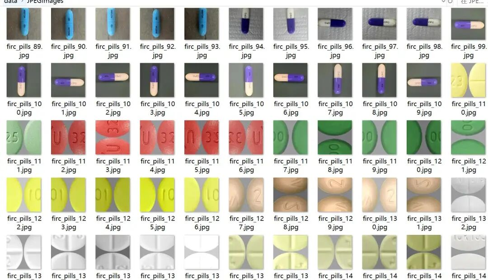
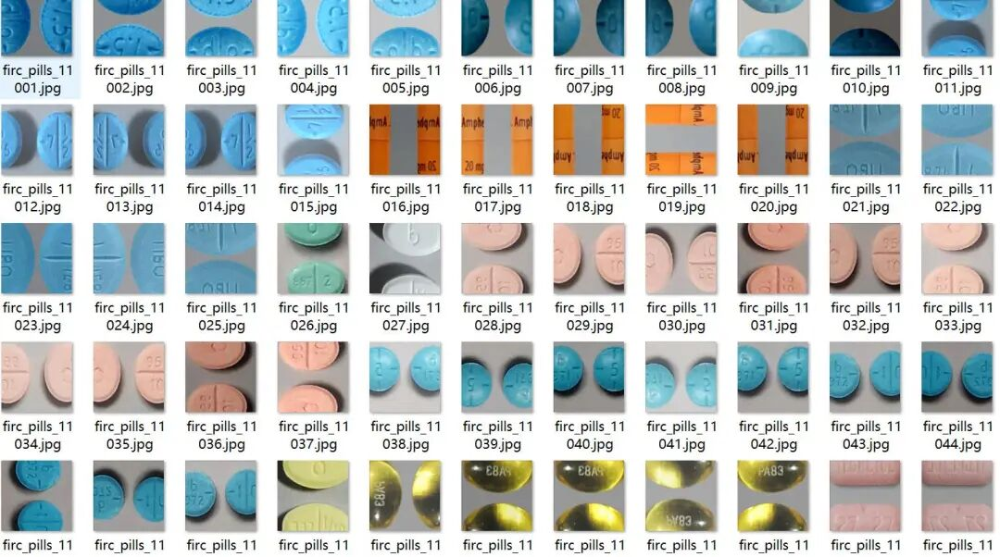
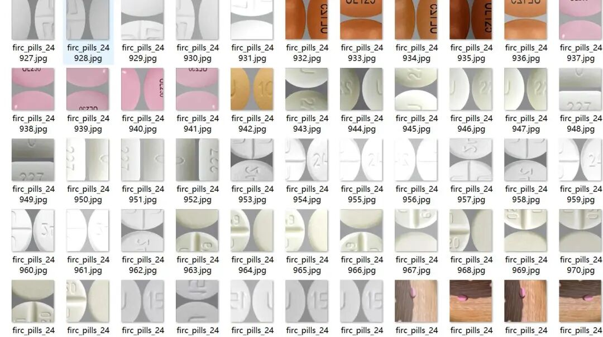
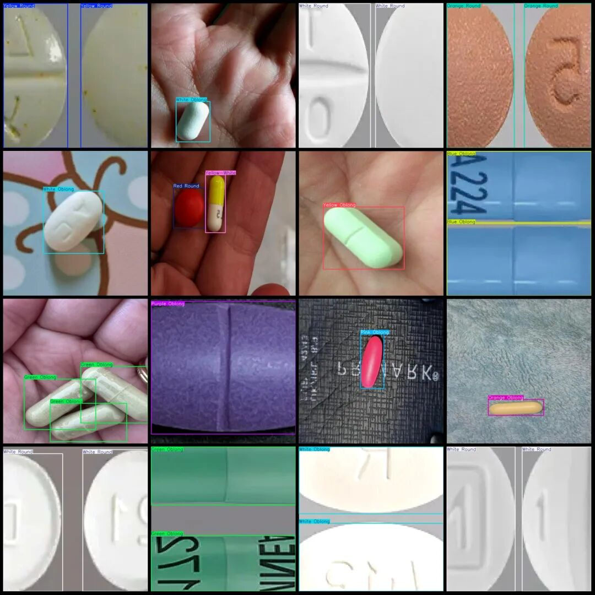

# Dataset of Different Medication Forms and Colors - VOC+YOLO format with 29277 images in 42 categories

Please note that approximately 7000 images in the dataset are original, while the remaining are enhanced.

Please note that approximately 7000 images in the dataset are original, while the remaining are enhanced.

Dataset format: Pascal VOC format + YOLO format (txt file without split path, only containing jpg images and corresponding VOC format xml files and yolo format txt files)

Number of images (number of jpg files): 29277

Number of annotations (number of xml files): 29,277

Number of annotations (number of txt files): 29,277

Labeling category count: 42

Label category names (Note that the order of yolo format categories does not correspond to this, but is based on the labels folder's classes.txt): ["Black Oblong", "Black Round", "Black-White", "Blue Oblong", "Blue Round", "Blue-Gray", "Blue-Orange", "Blue-White", "Gray Oblong", "Gray Round", "Green Oblong", "Green Round", "Green-Black", "Green-White", "Green-Yellow", "Orange Oblong", "Orange Round", "Orange-White", "Pink Oblong", "Pink Round", "Pink-Black", "Pink-Blue", "Pink-White", "Purple Oblong", "Purple Round", "Red Oblong", "Red Round", "Red-Black", "Red-Blue", "Red-Gray", "Red-Orange", "Red-White", "Red-Yellow", "White Heart", "White Oblong", "White Round", "Yellow Oblong", "Yellow Round", "Yellow Triangle", "Yellow-Gray", "Yellow-Orange", "Yellow-White"]

Number of boxes labeled in each category:

Black Oblong Frame Count = 270

Black Round Frame Count = 800

Black-White Frame Count = 11

Blue Oblong Frame Count = 3008

Blue Round Frame Count = 2717

Blue-Gray Frame Count = 136

Blue-Orange Frame Count = 42

Blue-White frame count = 443

Gray Oblong Frame Count = 573

Gray Round Frame Count = 287

Green Oblong Frame Count = 1754

Green Round Frame Count = 1291

Green-Black Frame Count = 50

Green-White Frame Count = 408

Green-Yellow Frame Count = 82

Orange Oblong Frame Count = 2657

Orange Round Frame Count = 3385

Orange-White Frame Count = 19

Pink Oblong Frame Count = 1494

Pink Round Frames = 2669

Pink-Black Frame Count = 15

Pink-Blue Frame Count = 22

Pink-White frame count = 48

Purple Oblong Frame Count = 411

Purple Round Frame Count = 170

Red Oblong Frame Count = 2900

Red Round Frame Count = 2017

Red-Black Frames = 30

Red-Blue Frame Count = 184

Red-Gray Frame Count = 230

Red-Orange Frame Count = 15

Red-White Frames = 118

Red-Yellow Frame Count = 728

White Heart Frame Count = 81

White Oblong Frame Count = 11734

White Round Frame Count = 9486

Yellow Oblong Frame Count = 3087

Yellow Round Frame Count = 4019

Yellow Triangle Frame Count = 11

Yellow-Gray Frame Count = 126

Yellow-Orange Frame Count = 91

Yellow-White frame count = 781

Total frame count: 58400

Using labelImg:

Annotation rules: Draw a rectangle around the category.

Important Notice: No

Image resolution: 640x640

Special : This dataset does not guarantee the accuracy of the trained models or weight files.

Image Preview:

Annotation example:

## Payment

Here is a pay link on Stripe ( https://buy.stripe.com/3cs8yP7sY87d0vu9AB ). Please contact me lonlonago@foxmail.com after funding $89, and I will send you a complete data files , thank you!

